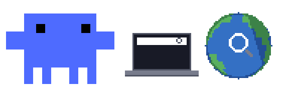
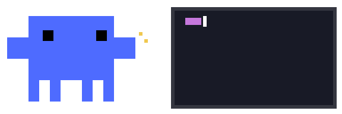
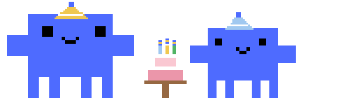

# blue-clawd-crab

A blue **Clawd** tamagotchi that lives above the prompt in
[dsh-TUI](https://github.com/ccch1mneyyy/dsh-tui) (DeepSeek Harness terminal).

It stands above the input line as a real sixel image (not ASCII), blinks while
idle, switches pose for every tool the agent runs, celebrates long sessions, and
dances when music is playing on Windows.


## What it looks like

<table>
  <tr>
    <td align="center"><br><sub>idle — stands and blinks</sub></td>
    <td align="center"><br><sub>search — greps with a globe</sub></td>
  </tr>
  <tr>
    <td align="center"><br><sub>writing — edits code</sub></td>
    <td align="center"><br><sub>celebrate — after a 5-minute run</sub></td>
  </tr>
</table>

These are this project's blue frames (art based on
[MyClawd](https://github.com/CodeChrisB/MyClawd)), exported as GIFs; in the
terminal the very same frames are painted as sixel images above the prompt.

## Features

- **Real pixels, not characters** — frames are painted with the terminal's
  sixel protocol (Windows Terminal 1.22+), so the crab looks like the original
  pixel art instead of blocky ASCII.
- **Pose per tool** — reads the actual tool call (name + command preview) and
  picks a matching animation: `reading`, `search`, `ide-connected`, `bash`,
  `browser`, `git`, `tests-pass`, `build`, `debug`, `todo-list`, `database`,
  `download`, `memory-write`, `docs-read`, `ask`, `permission`,
  `thinking-aloud`, `thinking`.
- **Idle life** — mostly `idle`; 5 % of rests pick a calm pose
  (`idle-coffee`, `idle-book`, `idle-juggle`, `idle-yawn`, `idle-look`);
  `idle-doze` after three quiet minutes.
- **Celebrations** — only after one continuous run longer than five minutes.
- **Music** — a small watcher reads the Windows media session (GSMTC, the same
  API as the Fn+F2 media popup) and the crab dances (`dj` or `radio`, 50/50)
  while a track plays.
- **English UI + short-terminal layout fix** for dsh-TUI.
- **Re-appliable** — dsh-tui updates overwrite its files; run `blue-crab install`
  again and every patch is re-applied. `blue-crab restore` puts everything back.

## Install

Requires Node.js 18+, a global `dsh-tui` (`dst`) install, and a terminal with
sixel support (Windows Terminal 1.22+; the patch also forces sixel inside
Windows Terminal because it does not advertise it).

From GitHub (works today):

```powershell
npm install -g github:okosdr/blue-crab
blue-crab install
```

From npm (once published):

```powershell
npm install -g blue-crab
```

Then restart the TUI:

```powershell
dst
```

The crab appears above the prompt. On first install the frames are copied to
`%USERPROFILE%\.dsh-tui\crab\`.

## Commands

| Command | What it does |
|---|---|
| `blue-crab` / `blue-crab install` | apply / re-apply every patch |
| `blue-crab restore` | restore the stock dsh-tui files |
| `blue-crab status` | show what is patched where |
| `blue-crab setup` | copy the bundled crab frames + music watcher to `~/.dsh-tui` |
| `blue-crab music` | start the Windows media-session watcher |
| `blue-crab map` | print every animation and what triggers it |
| `blue-crab sets` | list animation sets with frame counts |
| `blue-crab pose <set> [sec]` | force one pose for N seconds (handy for testing) |
| `blue-crab state` | show the live state files the crab reads |
| `blue-crab doctor` | list detected dsh-tui installations |

Flags: `--lang <en|zh|keep>`, `--no-layout`, `--no-mascot`, `--no-inline`,
`--dry-run`, `--quiet`, `--strict`.

## How the pose is chosen

The crab reads three small JSON files written by patched dsh-TUI components
(no network, no model calls — this costs **zero tokens**):

| File | Written by | Contents |
|---|---|---|
| `~/.dsh-tui/clawd-tool.json` | tool card | `tool`, `input` (command preview) |
| `~/.dsh-tui/clawd-state.json` | activity line | turn `phase`, `line` |
| `~/.dsh-tui/clawd-music.json` | music watcher | `playing`, `app`, `title` |

Priority while a turn runs: fresh tool → `ask` → music → thinking → idle.
`pwsh` commands are classified by their command line (`Get-Content` → reading,
`Select-String` → search, `Set-Content`/`apply_patch` → ide-connected), which
matters because DeepSeek's agent does most work through the shell.

Run `blue-crab map` for the full table.

## Uninstall

```powershell
blue-crab restore
npm uninstall -g blue-crab
```

## Credits

- **Animations**: [MyClawd](https://github.com/CodeChrisB/MyClawd) by
  **CodeChrisB** — pixel-art Clawd animation sets (fan project). The PNG frames
  in `frames/` are converted from that project's GIFs (cropped, background
  removed, crab recoloured blue).
- **Clawd**, the mascot: **Anthropic** (Claude Code). This is an unofficial fan
  project, not affiliated with Anthropic.
- **dsh-TUI**: [ccch1mneyyy/dsh-tui](https://github.com/ccch1mneyyy/dsh-tui) (MIT).
- **dsh / DeepSeek Harness**: DeepSeek.

See [NOTICE.md](NOTICE.md) for the licensing details of the artwork.

## License

Code: MIT (see [LICENSE](LICENSE)). Artwork: see [NOTICE.md](NOTICE.md).
